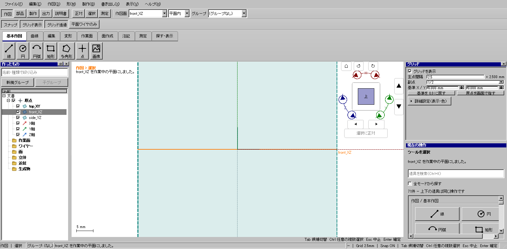
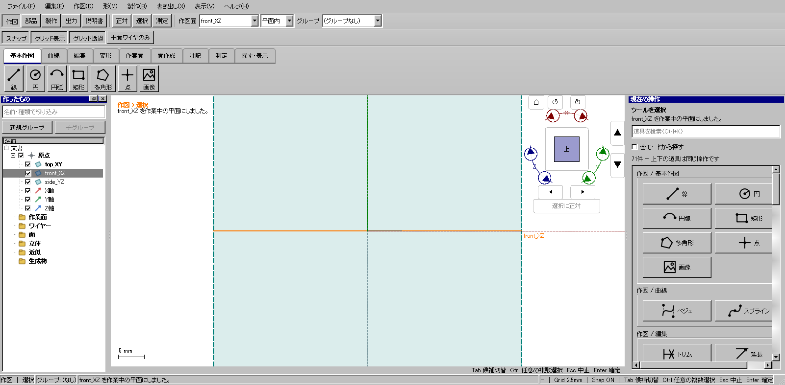

# グリッド設定欄を必要なときだけ表示する

2026-10-23のオーナー再指定。製品候補 `30e6b5864`、WP-08。

右上のグリッド設定欄は起動時に隠す。「作図 → 作業面 → グリッド」または道具検索の「グリッド」で開き、右上の×で閉じる。上部の「グリッド表示」「グリッド透過」ボタンは残す。設定欄の表示とグリッド描画の表示は独立する。

変更はDockの初期非表示と閉じるボタンの有効化。コア、保存形式、幾何計算、スナップ、ツール切替の意味は変更していない。

## 重点確認

WindowsのQtマウス/キーイベントを使った関連28件が成功。各倍率125/150/200%で変更対象の `HP-GRID-04` を1件ずつ追加実行し、全件成功。OS上で人間が手動クリックした試験とは区別する。

- 新しいウィンドウでは設定欄が非表示。
- 5モードそれぞれで明示的に開き、閉じられる。
- 閉じた欄がモード変更で勝手に開かない。
- 開閉でグリッド描画、現在のモード・ツール・文書履歴が変わらない。
- 作図途中の点と選択を保持し、欄のEnter/Escを作図の確定・取消へ流さない。
- 間隔の式、詳細の折畳み、作図面変更後のグリッド原点を維持する。
- 設定欄を閉じた後、右の操作パネルの確定/取消を使える。

ケース結果は同名フォルダーの `focused.json`、`dpi-1.25.json`、`dpi-1.5.json`、`dpi-2.json`。

全体検証 `grid-optional-verified-20261023` はWindows CTest 195件、skip 0、開発版・配布版のUI各566件、旧版self-testが成功。CTest実時間1655.72秒。通常デスクトップ起動で115系モデルを読み込み、イベントループ・表示・描画が成功した。設定欄が初期非表示である実画面も確認した。

検証済み配布先: `out/releases/grid-optional-verified-20261023/package/kachakacha_cad_next.exe`。証拠は同リリースの `verification.json` と `out/verification/grid-optional-verified-20261023/startup.json`。この配布物は次の開発と分離し保全する。
